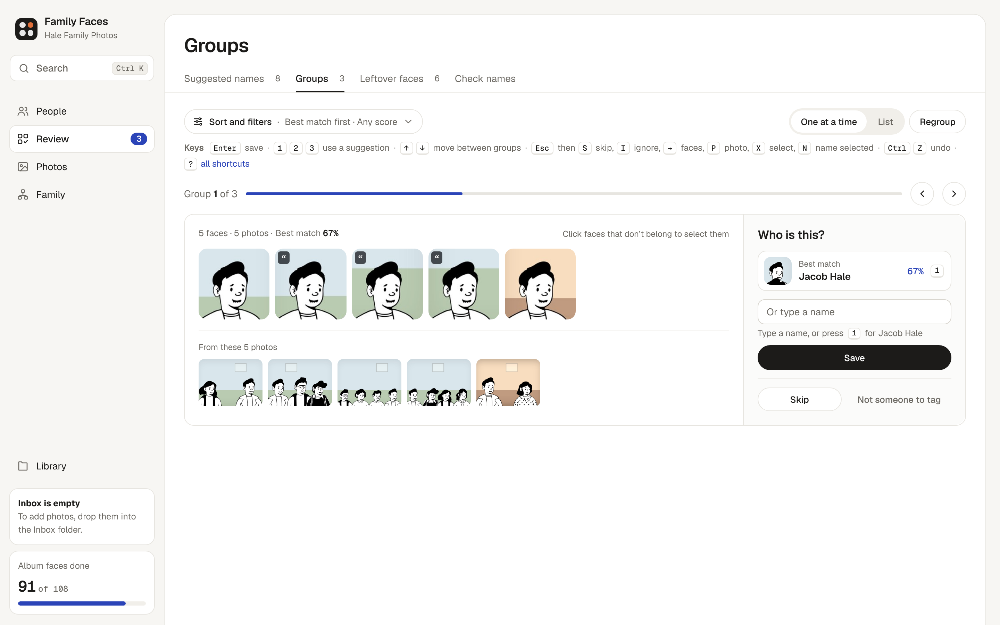
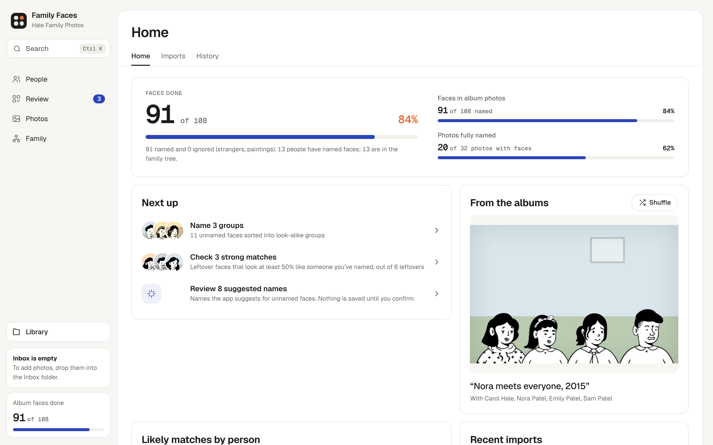
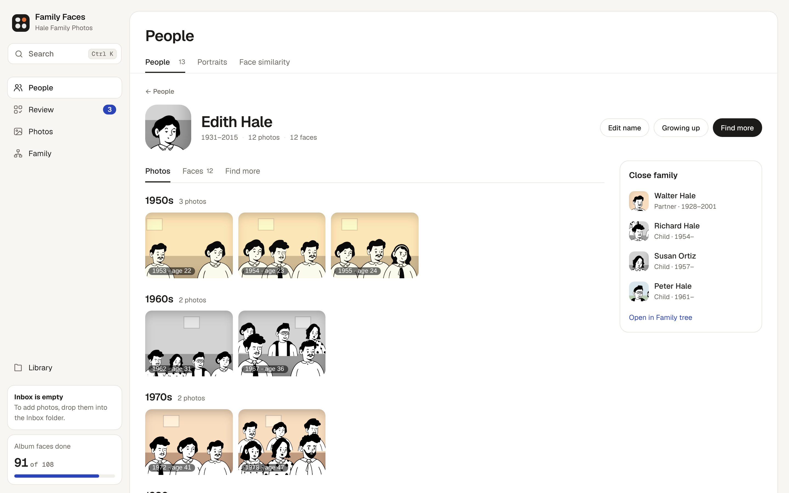
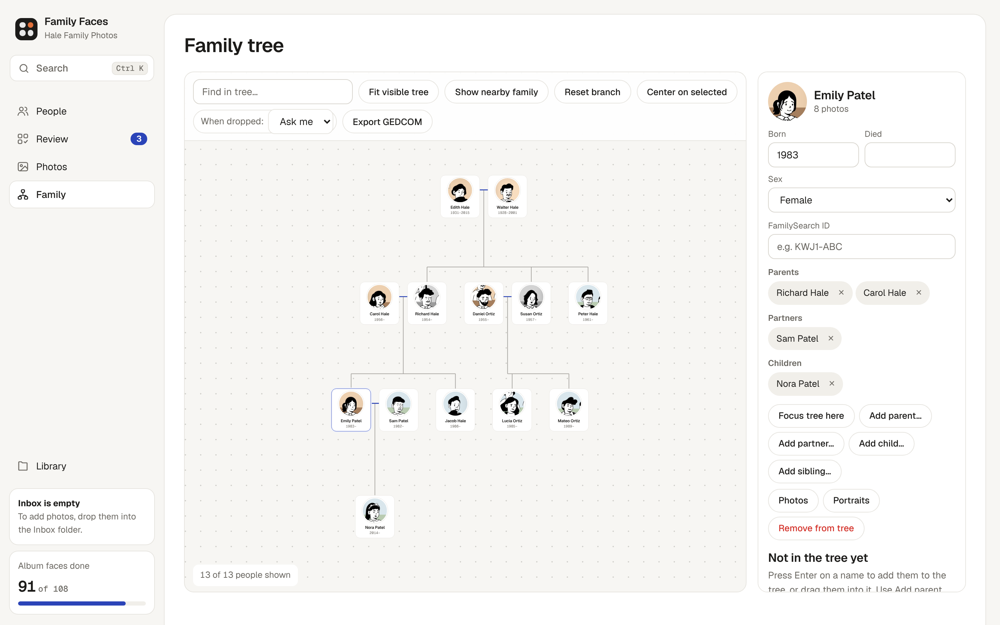
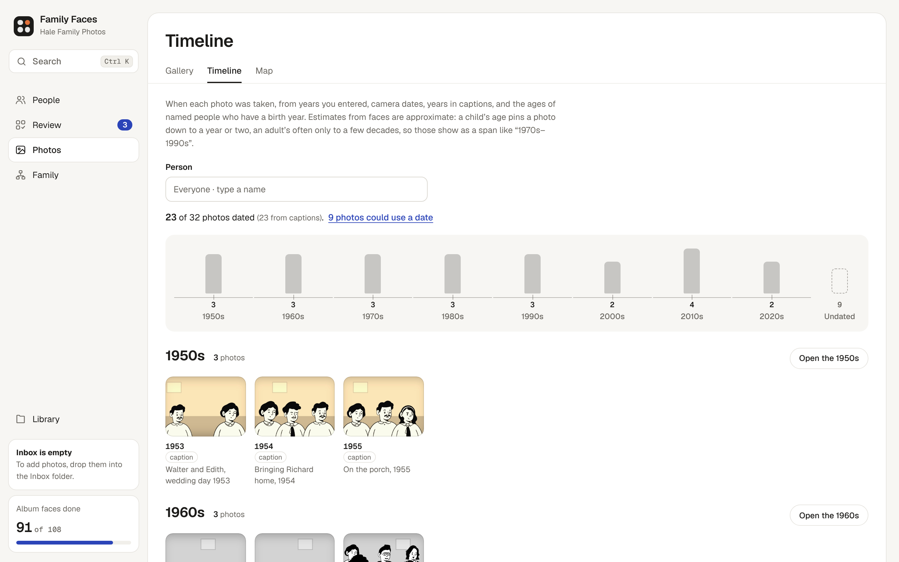

# Family Faces

I built Family Faces to put names to the people in my family's photo albums: about 18,000
photos and more than 42,000 faces across several generations. It finds every face, groups the ones
that look alike so I can name a whole group at once, and links the people to our family tree.

It runs entirely on your own computer, so your photos and names never leave it. I am making it open
source so other families can do the same with their albums.

- **Finds and groups faces.** Detects faces with InsightFace and groups the ones that look alike,
  so you name a whole group at once.
- **Suggests names, never applies them.** Likely matches come with a score, and nothing is named
  until you click. Every change can be undone from History.
- **Builds a family tree.** Add parents, partners and children, filter people by how closely they
  are related, and export GEDCOM for Ancestry, FamilySearch or any genealogy app.
- **Works with FamilySearch in both directions.** It reads the face tags relatives have added to
  FamilySearch Memories and uses those faces to find the same people in my albums, and it sends my
  named faces back to FamilySearch as tagged photos. That loop is how strangers in my albums get
  names.
- **Dates undated photos.** Estimates when a photo was taken from its caption, the ages of the
  people in it against their birth years, and how colourful the print is.
- **Shows people across their lives.** Portraits by age, "growing up" morph videos, and average
  faces by generation along the tree.



| | |
| --- | --- |
|  |  |
|  |  |

<sub>To keep my own family's photos private, these screenshots show a made-up family I drew with the CC0
[Notionists](https://www.dicebear.com/styles/notionists/) avatars. [tools/demo-library](tools/demo-library) rebuilds it.</sub>

## Install

You need [uv](https://docs.astral.sh/uv/) and Python 3.12 or newer.

```bash
git clone https://github.com/joshua-lawrence/family-faces
cd family-faces
uv sync
```

## Start

```bash
uv run python app.py --library ~/Pictures/Family
```

The first start looks through every photo in that folder and its subfolders (about a second per
photo on a laptop), groups the faces, and opens the app at http://localhost:8765. The folder is
remembered, so next time `uv run python app.py` is enough.

Your photos are never moved or changed. What the app learns from them (faces, names, the tree,
thumbnails) goes in `<library>/.family-faces`. Use `--data /some/other/folder` to keep it elsewhere.

## Adding photos later

1. Drop photos (JPG, PNG, TIFF, HEIC, WebP) into `<library>/Inbox`. Subfolders are fine.
2. Press **Process new photos** in the app.
3. Review them under **Imports**.

Each import is filed under `Added photos/<date>/`. HEIC and TIFF are converted to JPEG with the
originals kept, photos are turned upright, and exact duplicates are set aside.

A photo can bring its own notes in a JSON file beside it, named `<photo file name>.json`:

```json
{
  "caption": "Ann and Lee at the reunion",
  "date": "1988",
  "people": [
    {"name": "Ann Ward", "familysearch_id": "ABCD-123", "box": [0.12, 0.20, 0.31, 0.48]},
    {"name": "Lee Ward"}
  ]
}
```

`box` is the face as `[left, top, right, bottom]` fractions of the image. Face tags saved by Apple
Photos, Lightroom or Picasa are read the same way.

## Better matching (optional)

`uv run python -m family_faces.pipeline.reembed` adds [AdaFace](https://github.com/mk-minchul/AdaFace) fingerprints
alongside ArcFace. Download the IR-101 WebFace12M weights as
`~/.insightface/models/adaface_ir101_webface12m.safetensors` first. Then regroup with `uv run python -m family_faces.pipeline.cluster`.

On my own library of about 18,000 photos, I used `family_faces/pipeline/bakeoff.py` to measure how often a face's
nearest named face is the right person. I split the albums into five blocks and only matched faces
against other blocks, so a face can't be recognised from the same outfit on the next page.

| Model | All faces | Children under 10 | Faces under 80 px |
| --- | --- | --- | --- |
| ArcFace (buffalo_l) | 97.2% | 87.8% | 85.4% |
| ArcFace + AdaFace | 97.8% | 90.9% | 88.6% |

## Other tools

| Command | What it does |
| --- | --- |
| `uv run python -m family_faces.pipeline.cluster [threshold]` | Regroup faces (default 0.65; lower is stricter). Names are kept. |
| `uv run python -m family_faces.export` | Copy each person's photos to `<library>/_by_person/<Name>/` as hard links, plus a CSV. |
| `uv run python -m family_faces.pipeline.map` | Lay out every face on a map of look-alikes for the Map tab. |
| `uv run python -m family_faces.pipeline.attrs` then `-m family_faces.pipeline.age` | Aligned portraits and age estimates for the Portraits tab. |
| `uv run python -m family_faces.pipeline.orient` then `-m family_faces.pipeline.rotate --apply` | Find and fix sideways photos losslessly, keeping the originals. |

## Settings

`~/.config/family-faces/config.json` (or the file named by `FAMILY_FACES_CONFIG`):

```json
{
  "library": "/Users/you/Pictures/Family",
  "data": "/Users/you/Pictures/Family/.family-faces",
  "album_name": "Family albums",
  "home_person": "Ann Ward"
}
```

`FAMILY_FACES_LIBRARY` and `FAMILY_FACES_DATA` override the file. `home_person` is where the
family tree opens.

### FamilySearch (optional)

FamilySearch is where the rest of my family's knowledge lives, so the app connects to it in both
directions.

- **From FamilySearch into the app.** It imports face tags from FamilySearch Memories. Each tag
  links a face box to a person's tree ID, so a relative's tag gives me a known face with a name and
  a place in the tree, without any guessing. It can also bring in the tree around those people.
- **From the app back to FamilySearch.** I can upload album photos as new Memories, or add tags to
  a Memory that is already there, with the people I have named. Only the faces I pick become tags.

Together these turn unknown faces into known people. A face nobody in my house recognizes can match
a face a cousin tagged on FamilySearch years ago. The person's page has a "Find more" tab that
searches my albums for faces like that person's, and it can be limited to my mother's or father's
side of the tree so a match lands in the right branch. Going the other way, once I upload a photo
with the people I do know tagged, relatives working on that branch can see it and add the ones I
don't. Suggestions are never applied on their own: I still accept each name.

It talks to FamilySearch through two small Node scripts that you provide, which keep your sign-in
outside the app. Add them under
`"familysearch": {"connection_script": "...", "upload_script": "..."}`. Without them, the
FamilySearch features stay switched off.

## Model licenses

The code is MIT licensed. The face models are not part of this repository and have their own terms:
InsightFace's pretrained models (buffalo_l) are released for non-commercial research use, and
AdaFace weights follow their own license. Check those terms before using this in anything
commercial.

## Project layout

```
app.py                  Start here: picks the library, finds faces the first time, opens the app
family_faces/
  config.py             Where the library and the app's data live; optional integrations
  library.py            The photo library: scanning, captions, the Inbox
  people.py, tree.py    Who is who, and how they are related
  serve.py              The local web server (http://localhost:8765)
  api/                  One module per group of endpoints, loaded by serve.py
  pipeline/             Finding faces: detection, fingerprints, ages, grouping, the face map, Inbox imports
  familysearch/         Optional FamilySearch tags, tree hints and uploads
  web/                  The interface: review.html plus the scripts and styles it loads
  export.py, portraits.py, morph.py, photo_gallery.py, people_filters.py, family.py
tests/                  Python unittest and Node tests
docs/                   Design notes and README screenshots
tools/demo-library/     Builds the made-up family used in the screenshots
```

## Development

```bash
uv run python -m unittest discover -s tests
for f in tests/*.mjs; do node "$f"; done
```
